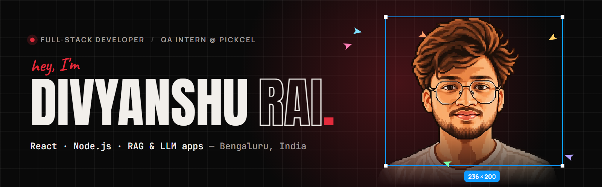

<p align="center">
  <a href="https://divyanshu-rai-portfolio.vercel.app">
    
  </a>
</p>

<p align="center">
  <a href="https://divyanshu-rai-portfolio.vercel.app">
    
  </a>
</p>

<p align="center">
  <a href="https://divyanshu-rai-portfolio.vercel.app"></a>
  <a href="https://linkedin.com/in/divyanshurai27"></a>
  <a href="mailto:raidivyanshu133@gmail.com"></a>
  <a href="https://leetcode.com/u/divyanshurai_27"></a>
</p>

<br />

## `01` &nbsp;About

```ts
const divyanshu = {
  role:     "Full-Stack Developer",
  now:      "QA Intern @ Pickcel — testing a web CMS & Android builds end to end",
  before:   "Software Engineering Intern @ Vaultofcodes — 15+ REST endpoints, 25+ PRs",
  location: "Bengaluru, India",
  building: ["React frontends", "REST & event-driven backends", "RAG / LLM apps"],
  askMeAbout: ["Java", "Node.js", "Microservices", "RAG pipelines", "DSA"],
  funFact:  "I ideate best with chai ☕ and solve bugs like puzzles",
};
```

## `02` &nbsp;Featured work

<table>
  <tr>
    <td width="50%" valign="top">
      <h3><a href="https://github.com/divyanshurai27/AI-Powered-Hyperlocal-Air-Quality-and-Personalized-Respiratory-Health-Alert-System">AeroGard</a></h3>
      <sub><b>AI / ML</b> · 2026</sub>
      <p>24-hour air-quality forecasts for Bengaluru turned into personalised, explainable respiratory-risk alerts for asthma and COPD patients.</p>
      <p><b>+23%</b> PM2.5 forecast vs persistence<br /><b>0.71</b> risk AUROC <sub>(synthetic cohort)</sub></p>
      <code>FastAPI</code> <code>PostgreSQL</code> <code>LightGBM</code> <code>SHAP</code> <code>Pytest</code>
    </td>
    <td width="50%" valign="top">
      <h3><a href="https://github.com/divyanshurai27/ask-my-doc">Ask My Docs</a></h3>
      <sub><b>AI / LLM</b> · 2026</sub>
      <p>Cited question-answering over private PDF, Markdown and TXT documents, with hybrid BM25 + dense retrieval and a switchable OpenAI / Groq backend.</p>
      <p><b>1.00</b> Ragas faithfulness<br /><b>33</b> Pytest tests in CI</p>
      <code>Python</code> <code>LangChain</code> <code>ChromaDB</code> <code>Groq</code> <code>Ragas</code>
    </td>
  </tr>
  <tr>
    <td width="50%" valign="top">
      <h3><a href="https://github.com/divyanshurai27/TaskManager">TaskFlow</a></h3>
      <sub><b>Backend</b> · 2026</sub>
      <p>A task-management backend split into three Node.js microservices that talk through RabbitMQ events, with a dead-letter queue and one-command Docker setup.</p>
      <p><b>3</b> services · <b>3</b> event types<br /><b>E2E</b> flow test in GitHub Actions</p>
      <code>Node.js</code> <code>Express</code> <code>RabbitMQ</code> <code>MongoDB</code> <code>Docker</code>
    </td>
    <td width="50%" valign="top">
      <h3><a href="https://github.com/divyanshurai27/Bookstore">Bookstore</a></h3>
      <sub><b>Web App</b> · 2026</sub>
      <p>A full-stack MERN book catalog with signup and login, built solo from the React UI to the MongoDB data model.</p>
      <p><b>10</b> reusable components<br /><b>46</b> commits, UI to database</p>
      <code>React</code> <code>Tailwind</code> <code>Express</code> <code>MongoDB</code> <code>bcrypt</code>
    </td>
  </tr>
</table>

<p align="center"><a href="https://divyanshu-rai-portfolio.vercel.app/#work"><b>See the case studies on my portfolio →</b></a></p>

## `03` &nbsp;Stack

<p align="center">
  
  <br />
  
</p>

<p align="center">
  
  
  
  
  
  
  
</p>

## `04` &nbsp;Wins

- **Team Lead, Smart India Hackathon** — led a 6-member team through the internal and national rounds
- **Backend Lead, ChipToCrop Hackathon** — shipped the REST API and data layer for an agri-tech platform in 36 hours
- **Top 12 of 990** at Innovation Tech 2024 — 5+ hackathons, 2 Top-5 finishes
- **250+ DSA problems** solved across LeetCode and other platforms

## `05` &nbsp;Activity

<p align="center">
  
</p>

<p align="center">
  <picture>
    <source media="(prefers-color-scheme: dark)" srcset="https://raw.githubusercontent.com/divyanshurai27/divyanshurai27/output/snake-dark.svg" />
    <source media="(prefers-color-scheme: light)" srcset="https://raw.githubusercontent.com/divyanshurai27/divyanshurai27/output/snake-light.svg" />
    
  </picture>
</p>

<p align="center">
  <sub>Built the same way I build everything — then tested it twice. &nbsp;·&nbsp; <a href="https://divyanshu-rai-portfolio.vercel.app">divyanshu-rai-portfolio.vercel.app</a></sub>
</p>
